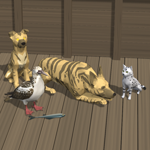

**Download the beta:** [FurstMate 0.9.6 (beta 1)](https://github.com/Dixiecapt/FurstMate/releases/tag/v0.9.6-beta1). Take `FurstMate-0.9.6.zip` to install by hand, or `FurstMate-0.9.6-thunderstore.zip` for a mod manager.

# FurstMate 0.9.6 (beta)

Three ship's animals for Sailwind: a dog you buy, a tavern cat you win with
food, and a wild booby who finds you at sea. Each one lives aboard your
ship, needs feeding, and does a job for you.

**This is a beta.** Everything below works in testing, but it has only been
sailed by one captain so far. Please read *Testing the beta* at the end and
tell us what you find.

| | Dog | Cat | Bird |
|---|---|---|---|
| What she is | Aestrin Shepherd | Ship's mouser | Wild booby |
| Where you find her | Bone Isle kennel, below the lighthouse | Gold Rock City tavern, on the rumour man's table | At sea, in warm open water |
| How you get her | Buy her as a puppy, 400 Aestrin Crowns | Feed her once, free | Feed her fish or meat during a visit, free |
| Her job | Warns of pirates; full grown, cuts what they take (with Dangerous Waters) | Food on her ship spoils 40% slower | Senses land, warns of hidden land in fog, brings you fish |
| Commands | Heel, Stay, Sleep, Sleep spot, Pet, Here | Pet | None |
| A full belly lasts | 2 game days | 14 game days | 14 game days |

All three work the same way with your hands: look at her to read her name,
what she is doing and her food; hold food and click her to feed her; click
her with empty hands for her board.

The full **FurstMate Manual**, with pictures of every pose, comes with the
mod. It covers every behaviour, every note and every setting.

---

## The dog: an Aestrin Shepherd

- **Find her** on Bone Isle, about 12 km north-west of Fort Aestrin. Anchor
  off the long south-east beach and walk up to the terrace below the
  lighthouse. The keeper is at the kennel gate from 7:00 to 18:00.
- **Buy her:** click the keeper, his puppy or the sign; click again within
  8 seconds. She goes aboard your ship. You need a ship of your own.
- **She grows up** over a year of game days (the Climate mod's year, or 92
  days without Climate): puppy, young pup, big pup, half grown, nearly
  grown, full grown. A note tells you each step.
- **Feeding:** hold food and click her. Meat and fish fill her three times
  as much. Bowls and soup mugs from Vittles and Stir-Fry work. At 0% she
  falls asleep and does nothing until fed.
- **Commands** on her board: **Heel**, **Stay** (a minute for each day of
  her age, up to 92 minutes full grown), **Sleep**, **Sleep spot**, **Pet**.
  **Here** (Alt+H, or the F1 switch *Here now*) brings her to you, or makes
  the ship or home you stand on hers.
- **She walks the decks** with you, up and down stairs and through open
  hatches. A shut hatch or door stops her as it stops you.
- **Her job** needs the Dangerous Waters mod: she scents a pirate at 1 km
  and gives tongue; full grown, fed and aboard, boarders take one item
  fewer and half the coin, and with her at your side each blow to their
  nerve costs them 15% more.
- **Weather:** ordinary waves don't bother her. A storm or a hard lean and
  she braces; a severe storm sends her to shelter, whining.

## The cat: the ship's mouser

- **Find her** in the tavern at Gold Rock City, on the rumour man's table.
  The bartender will warn you about feeding her.
- **Win her:** hold food and click her. Step aboard a ship of yours and she
  is there.
- **Her job:** all the food on her ship spoils 40% slower, Vittles and
  Stir-Fry dishes included, even while you are ashore.
- **She lives her own life:** strolls between her roosts, washes, sleeps,
  hunts under way and plays with what she catches. Each mouse adds 1% to
  her food, so she needs feeding far less often than the dog.
- **Pet her** from her board and she settles and purrs.
- She crosses to another ship of yours within 50 m by herself.

## The bird: a wild booby

- **She finds you:** sailing over 3 knots in warm open water, more than 6 km
  from land and out of the storms, a booby may come in from astern and
  land by you. A visit lasts 10 to 15 minutes, and she comes down to you
  three times.
- **Keep her:** hold fish or meat (a raw slice will do) and click her. Let
  three visits pass unfed and she stops coming (F1 *Reset her tries now*
  starts them again).
- **Her jobs:** she senses land within 75 sea miles and calls from the bow;
  in fog or heavy rain with land hidden ahead she hangs over the bow and
  cries; in calm weather she dives and drops a real raw fish on your deck
  now and then.
- **Perches:** mast tops, yard ends, the bowsprit, and the rails by you.
- She feeds herself by diving under way, and comes to whichever ship of
  yours you stand on.

## Living at home

Press **Here** inside a home you own, and the dog and the cat live there
instead of on a ship: in the house and on the ground around it (20 m by
default, F1 *Home*). Stand on a ship of yours and press Here to take them
back to sea. The bird stays with her ship.

## F1 settings

Every number in this README is a setting: prices, sizes, the dog's name and
coat colours, how fast bellies empty, how loud each pet is and how far each
sound carries, the bird's chances and waters, and more. Each has a note in
the F1 menu, and the manual lists them all with their defaults. The
*Testing* section has switches to give, starve, tame or summon a pet at once.

## Works with

- **Dangerous Waters:** the dog's work against pirates. Without it she is
  company only.
- **Climate:** the dog's year follows Climate's year.
- **Vittles and Stir-Fry:** bowls and soup mugs feed the pets; the cat's
  spoilage cut covers their dishes.
- Stock ships and modded ships alike: each pet reads the decks of the ship
  she is on.

## Installing and removing

Put the **FurstMate** folder in `BepInEx\plugins`. It holds `FurstMate.dll`,
three model files (`furstmate`, `furstcat`, `furstbird`) and a `Sounds`
folder. All of them must stay together.

FurstMate keeps your pets in the save's mod notes, which the game holds on
to but ignores without the mod, so a save still loads without it. Long play
without the mod has not been tested.

## Testing the beta

Please tell us when something looks wrong: a pet stuck, walking through a
wall, on the wrong deck, too loud, or simply not doing what this README
says. Each report helps most with:

1. what you were doing, which ship, and where on her you stood;
2. the file `BepInEx\LogOutput.log`, from the same game session, before you
   start the game again (it is replaced each time the game starts).

Pressing **Here** (Alt+H) fetches the dog or the cat out of almost any
trouble.

## Credits

- **Models:** the dog, puppy, cat and booby were made with **Meshy**
  (Models created with Meshy, CC BY 4.0), then cut, rigged, posed and
  animated for the game by Dixiecapt.
- **Booby calls** from xeno-canto, cut and cleaned:
  - Roger Ahlman, XC135237, www.xeno-canto.org/135237, CC BY-NC-SA 3.0
  - Oscar Campbell, XC332855, www.xeno-canto.org/332855, CC BY-NC-SA 4.0
  - Manuel Grosselet, XC335797, www.xeno-canto.org/335797, CC BY-NC-SA 4.0

  The files made from them (`bird_call.wav`, `bird_alarm.wav`,
  `bird_brown.wav`) are shared under CC BY-NC-SA 4.0: free to use and
  change with credit, not for sale.
- **Wing beats** (`bird_beat1-7.wav`): cut from *Bird Wings* by Dragon
  Studio, Pixabay (Pixabay Content License).
- **Dog sounds:** Pixabay (Pixabay Content License).
- **Cat sounds:** Pixabay (Pixabay Content License), with purrs and meows
  from BigSoundBank and freesound (CC0: cubilon, lostphosphene).
- **Mod, behaviour and testing:** Dixiecapt.

## Version history

- **0.9.6 (beta 1):** the first public build. The dog, the cat and the
  booby, with their deck maps, stairs and hatches; pets at home; Pet for
  the dog and the cat; Stay that grows with the dog's age; pets used to
  ordinary waves; quieter, shorter-carrying panting and bird calls; the
  bird's perches found on rails, mast tops, yards and the bowsprit.
